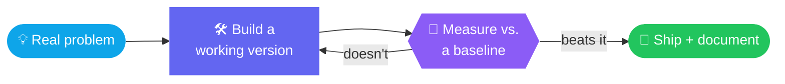
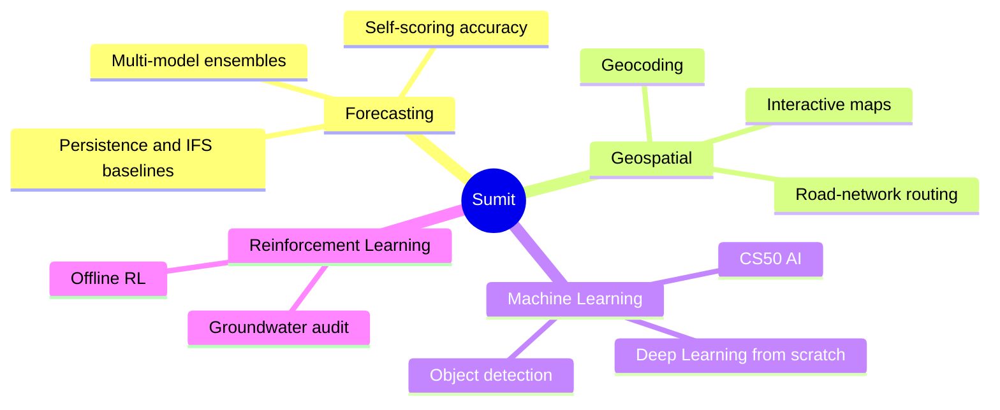

<!--
  GitHub Profile README — Sumit Kumar Biswal
  Repo name must be exactly: sonubiswal   (README.md at repo root)

  Files used by this README:
    assets/header.svg                       animated hero banner (swapped automatically by the time of day)
    assets/banners/*.svg                    9 time-of-day variants: dawn, sunrise, morning, noon,
                                            afternoon, sunset, dusk, night, midnight
    assets/footer.svg                       animated wave footer
    assets/divider.svg                      animated section divider
    .github/workflows/update-banner.yml     picks the banner for the current IST time
    .github/workflows/profile-3d.yml        generates the 3D contribution graph
    .github/workflows/snake.yml             (already set up) contribution snake
-->

 

  

<a href="#-about-me">About</a> &nbsp;•&nbsp;
<a href="#-how-i-work">How I Work</a> &nbsp;•&nbsp;
<a href="#-tech-arsenal">Tech</a> &nbsp;•&nbsp;
<a href="#-featured-projects">Projects</a> &nbsp;•&nbsp;
<a href="#-learning--coursework">Coursework</a> &nbsp;•&nbsp;
<a href="#-github-analytics">Analytics</a> &nbsp;•&nbsp;
<a href="#-the-banner-follows-the-sun">Banner</a> &nbsp;•&nbsp;
<a href="#-lets-connect">Connect</a>

 

🌅 The header above changes with the time of day in India. <a href="#-the-banner-follows-the-sun">See all 9 moods</a>.

<!-- ══════════════════════════════ ABOUT ══════════════════════════════ -->

<h2 align="center">🧭 About Me</h2>

<table>
<tr>
<td width="200" align="center" valign="middle">

</td>
<td valign="top">

I'm an engineer who learns by <strong>shipping</strong>. Rather than stopping at a notebook, I take ideas all the way to working products: desktop applications, interactive maps, and models that <strong>grade their own accuracy</strong>.

My work sits at the intersection of <strong>applied machine learning</strong>, <strong>geospatial tooling</strong>, and <strong>clean software architecture</strong>. I care about the part most people skip: proving a system actually beats a baseline.

<pre>
class SumitKumarBiswal:
    role       = "AI &amp; Automation Engineer in Training"
    education  = ["CS50x", "CS50 AI",
                  "DeepLearning.AI Specialization"]
    focus      = ["Forecast validation", "Applied ML",
                  "Deep Learning", "Reinforcement Learning"]
    philosophy = "Build it, measure it, prove it beats the baseline."
</pre>

</td>
</tr>
</table>

<!-- ══════════════════════════════ HOW I WORK ══════════════════════════════ -->

<h2 align="center">🔁 How I Work</h2>

<!-- ══════════════════════════════ 3D CONTRIBUTIONS ══════════════════════════════ -->

<h2 align="center">🧊 3D Contribution Graph</h2>

<!-- Appears after the profile-3d workflow runs once (Actions → GitHub-Profile-3D-Contrib → Run workflow) -->

<!-- ══════════════════════════════ TECH ARSENAL ══════════════════════════════ -->

<h2 align="center">🧰 Tech Arsenal</h2>

 

<table align="center">
<tr>
<td align="right" width="22%"><strong>Languages</strong></td>
<td align="left" width="78%">

</td>
</tr>
<tr>
<td align="right"><strong>AI &amp; Data</strong></td>
<td align="left">

</td>
</tr>
<tr>
<td align="right"><strong>Apps &amp; Web</strong></td>
<td align="left">

</td>
</tr>
<tr>
<td align="right"><strong>Tooling</strong></td>
<td align="left">

</td>
</tr>
</table>

<!-- ══════════════════════════════ PROJECTS ══════════════════════════════ -->

<h2 align="center">🚀 Featured Projects</h2>

<table>
<tr>
<td width="55%" valign="top">

<h3>🌦️ Weather Forecasting</h3>

<strong>The idea:</strong> one forecast is a guess; an ensemble is evidence.

This desktop app queries <strong>four independent forecast models</strong> in parallel (ECMWF IFS, ECMWF AIFS, GFS, and ICON), then reports the <strong>median with a confidence spread</strong> instead of a single number.

<strong>What makes it different:</strong> it grades its own accuracy against observed conditions and benchmarks against <strong>persistence</strong> and <strong>IFS</strong> baselines, so you can see exactly when the ensemble is worth trusting.

</td>
<td width="45%" valign="top" align="center">

 

</td>
</tr>
</table>

<table>
<tr>
<td width="45%" valign="top" align="center">

 

</td>
<td width="55%" valign="top">

<h3>⚡ EV Charging Finder</h3>

<strong>The idea:</strong> range anxiety is a data problem, not a car problem.

Enter a location in India and get the <strong>nearest EV charging station with a real driving route</strong> drawn on an interactive map: not a straight line, an actual road-network path.

<strong>What's inside:</strong> a modern <strong>3D landing page</strong>, a <strong>live demo</strong>, and a Python backend that geocodes, routes, and renders <strong>standalone HTML maps</strong> you can open or share anywhere.

</td>
</tr>
</table>

<table>
<tr>
<td width="55%" valign="top">

<h3>🌊 Offline RL — Groundwater Audit</h3>

<strong>The idea:</strong> you can't run experiments on an aquifer.

This project applies <strong>offline reinforcement learning</strong> to groundwater monitoring and audit tasks, learning and evaluating policies purely from <strong>historical data</strong>, with no online interaction with the environment.

<strong>Why it matters:</strong> it turns logged records into decision-making policy, which is exactly the constraint real environmental monitoring operates under.

</td>
<td width="45%" valign="top" align="center">

 

</td>
</tr>
</table>

<!-- ══════════════════════════════ COURSEWORK ══════════════════════════════ -->

<h2 align="center">🎓 Learning &amp; Coursework</h2>

<table>
<tr>
<td width="50%" valign="top">

<h3>🤖 <a href="https://github.com/sonubiswal/CS50-AI-Work">CS50 AI</a></h3>

All <strong>12 CS50 AI projects</strong> complete: search algorithms, knowledge representation, uncertainty, optimization, learning, neural networks, and natural language processing.

</td>
<td width="50%" valign="top">

<h3>🎯 <a href="https://github.com/sonubiswal/deep-learning-c1-neural-networks-and-deep-learning">Deep Learning Specialization</a></h3>

Neural networks and deep learning <strong>from scratch</strong>: backpropagation, regularization, and optimization, plus practical implementations from the DeepLearning.AI Specialization.

</td>
</tr>
<tr>
<td valign="top">

<h3>📘 <a href="https://github.com/sonubiswal/CS50x-Work">CS50x</a></h3>

Complete CS50x coursework (C and memory management, Python, SQL, and Flask), capped by a full-stack final project: <strong>StudyTrack</strong>, a study session tracker.

</td>
<td valign="top">

<h3>👁️ <a href="https://github.com/sonubiswal/yolo-object-detection">YOLO Object Detection</a></h3>

A real-time object detection pipeline built on YOLO, covering the full loop of training, inference, and evaluation workflows.

</td>
</tr>
</table>

<!-- ══════════════════════════════ ANALYTICS ══════════════════════════════ -->

<h2 align="center">📊 GitHub Analytics</h2>

<picture>
  <source media="(prefers-color-scheme: dark)" srcset="https://github-readme-stats.vercel.app/api?username=sonubiswal&show_icons=true&include_all_commits=true&count_private=true&hide_border=true&rank_icon=github&title_color=38BDF8&icon_color=38BDF8&text_color=c9d1d9&bg_color=00000000" />
  
</picture>
<picture>
  <source media="(prefers-color-scheme: dark)" srcset="https://github-readme-stats.vercel.app/api/top-langs/?username=sonubiswal&layout=compact&langs_count=8&hide_border=true&title_color=38BDF8&text_color=c9d1d9&bg_color=00000000" />
  
</picture>

 

<picture>
  <source media="(prefers-color-scheme: dark)" srcset="https://streak-stats.demolab.com?user=sonubiswal&theme=github-dark-blue&hide_border=true&background=00000000&card_width=800&date_format=j%20M%5B%20Y%5D" />
  
</picture>

  

  

 

  

<h3>🏆 Trophies</h3>

<!-- ══════════════════════════════ SNAKE ══════════════════════════════ -->

<h3>🐍 Contribution Snake &nbsp;(click to expand)</h3>

 

<picture>
  <source media="(prefers-color-scheme: dark)" srcset="https://raw.githubusercontent.com/sonubiswal/sonubiswal/output/github-snake-dark.svg" />
  <source media="(prefers-color-scheme: light)" srcset="https://raw.githubusercontent.com/sonubiswal/sonubiswal/output/github-snake.svg" />
  
</picture>

<!-- ══════════════════════════════ FOCUS ══════════════════════════════ -->

<h2 align="center">🎯 What I'm Working On</h2>

| Area | In practice |
| :--- | :--- |
| 📈 **Forecast validation** | Systems that score their own accuracy and beat persistence baselines |
| 🗺️ **Applied ML for real problems** | Routing, weather, and environmental monitoring |
| 🧠 **Deep learning** | From-scratch implementations → production pipelines |
| 🛠️ **Shipping complete projects** | Clean architecture, live demos, real documentation |

<!-- ══════════════════════════════ BANNER FOLLOWS THE SUN ══════════════════════════════ -->

<h2 align="center">🌗 The Banner Follows the Sun</h2>

The header at the top is not a fixed image. A small <strong>GitHub Action</strong> swaps it through <strong>9 hand-built scenes</strong> across the day, timed to <strong>India Standard Time</strong>. 
Visit at sunrise, noon, or past midnight and you'll see a different sky.

<b>🖼️ See all 9 moods (click to expand)</b>

 

<table>
<tr>
<td width="33%" align="center"> <b>🌄 Dawn</b> 4:30 – 6:30 AM</td>
<td width="33%" align="center"> <b>🌅 Sunrise</b> 6:30 – 9:30 AM</td>
<td width="33%" align="center"> <b>🌤️ Morning</b> 9:30 AM – 12:00 PM</td>
</tr>
<tr>
<td align="center"> <b>☀️ Noon</b> 12:00 – 3:00 PM</td>
<td align="center"> <b>🌞 Afternoon</b> 3:00 – 5:00 PM</td>
<td align="center"> <b>🌇 Sunset</b> 5:00 – 6:30 PM</td>
</tr>
<tr>
<td align="center"> <b>🌆 Dusk</b> 6:30 – 7:30 PM</td>
<td align="center"> <b>🌙 Night</b> 7:30 – 11:30 PM</td>
<td align="center"> <b>🌌 Midnight</b> 11:30 PM – 4:30 AM</td>
</tr>
</table>

Every scene is a single hand-coded animated SVG (no images, no JavaScript): moving waves, drifting clouds, flying birds, twinkling stars, and shooting stars at night.

<!-- ══════════════════════════════ CONNECT ══════════════════════════════ -->

<h2 align="center">🤝 Let's Connect</h2>

Interested in forecasting, geospatial tooling, or applied ML? 
Open an issue, star a repo, or reach out. I'm happy to talk shop.

<!--
  Replace "#" with real URLs and remove the surrounding comment markers
  to activate any of the additional links below.

-->

  

 

Made with Python, curiosity, and a lot of coffee.

