<!--
  GitHub Profile README — Sumit Kumar Biswal
  Repo name must be exactly: sonubiswal   (README.md at repo root)

  Files used by this README:
    assets/header.svg                       hero banner (swapped by the time of day)
    assets/banners/*.svg                    the time-of-day banner variants
    assets/footer.svg                       animated wave footer
    .github/workflows/update-banner.yml     picks the banner for the current IST time
    .github/workflows/snake.yml             contribution snake
    .github/workflows/profile-3d.yml        3D contribution graph
-->

 

  

<a href="#about">About</a> &nbsp;·&nbsp;
<a href="#featured-projects">Projects</a> &nbsp;·&nbsp;
<a href="#skills">Skills</a> &nbsp;·&nbsp;
<a href="#education">Education</a> &nbsp;·&nbsp;
<a href="#github-activity">Activity</a> &nbsp;·&nbsp;
<a href="#the-banner-follows-the-sun">Banner</a> &nbsp;·&nbsp;
<a href="#contact">Contact</a>

 

## About

I'm an AI & automation engineer in training, based in India, and I learn by **shipping**. Rather than stopping at a notebook, I take ideas all the way to working products: desktop applications, interactive maps, and models that grade their own accuracy.

My work sits at the intersection of **applied machine learning**, **geospatial tooling**, and **clean software architecture**. I care about the part most people skip: proving that a system actually beats a baseline.

> *Build it, measure it, prove it beats the baseline.*

**Currently focused on**

- **Forecast validation:** systems that score their own accuracy against baselines
- **Applied ML for real problems:** weather, routing, and environmental monitoring
- **Deep learning:** from-scratch implementations through to working pipelines

### How I work

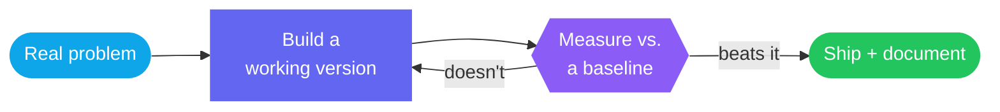

<b>Skill map</b>

 

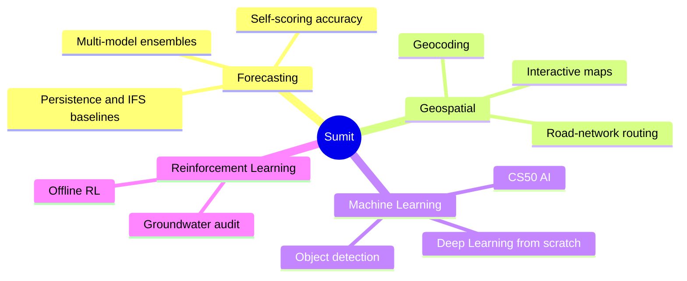

 

## Experience

**AI/ML Intern** · National Aluminium Company Limited (NALCO)
*Jun 2025 – Jul 2025 · Damanjodi, Odisha*
- Engineered an edge-deployable YOLOv8 PPE detection system trained on 5,000+ industrial images, achieving 82% classification accuracy and reducing manual inspection overhead by ~30%.

**Full-Stack Developer Intern** · GIET University
*Jun 2024 – Jul 2024 · Gunpur, Odisha*
- Built a full-stack Library Management System (Python/Flask, SQL) featuring book search, checkout, and admin/inventory controls with optimized queries.

 

## Featured Projects

### [SentinelVision](https://github.com/sonubiswal/sentinelvision)

*The model is about 20% of the work. The other 80% is association, rules, and operations.*

Per-worker PPE compliance from the cameras a site already owns. It binds every PPE observation to a **tracked worker**, applies a configurable policy, and only commits a violation after an **N-of-M temporal vote** (6 of 10 frames), so one blurry frame never raises an alert. Events are written to a **SHA-256 hash-chained audit trail** you can verify. Phase 2 is complete, with a Gradio demo, a CLI, and 289 weight-free tests at 96% coverage; the zone engine, audit store, and dashboard are on the roadmap.

`Python` · `YOLOv8` · `ByteTrack` · `OpenCV` · `Gradio`

[**View repository →**](https://github.com/sonubiswal/sentinelvision) &nbsp;·&nbsp; [**Live site →**](https://sentinelvision-sonubiswal.netlify.app)

 

### [Weather Forecasting](https://github.com/sonubiswal/Weather-Forecasting)

*One forecast is a guess; an ensemble is evidence.*

A desktop app that queries four independent forecast models in parallel (ECMWF IFS, ECMWF AIFS, GFS, and ICON) and reports the **median with a confidence spread** instead of a single number. It grades its own accuracy against observed conditions and benchmarks against **persistence** and **IFS** baselines, so you can see exactly when the ensemble is worth trusting.

`Python` · `PySide6` · `Open-Meteo`

[**View repository →**](https://github.com/sonubiswal/Weather-Forecasting)

 

### [EV Charging Finder](https://github.com/sonubiswal/EV-Charging-Finder)

*Range anxiety is a data problem, not a car problem.*

Enter a location in India and get the nearest EV charging station with a **real driving route** drawn on an interactive map: an actual road-network path, not a straight line. Includes a 3D landing page, a live demo, and a Python backend that geocodes, routes, and renders standalone HTML maps you can open or share anywhere.

`Python` · `Folium` · `geopy` · `OSRM` · `Leaflet`

[**View repository →**](https://github.com/sonubiswal/EV-Charging-Finder) &nbsp;·&nbsp; [**Live demo →**](https://sonubiswal.github.io/EV-Charging-Finder/)

 

### [Offline RL: Groundwater Audit](https://github.com/sonubiswal/offline-rl-groundwater-audit)

*You can't run experiments on an aquifer.*

Applies **offline reinforcement learning** to groundwater monitoring and audit tasks, learning and evaluating policies purely from historical data with no online interaction. It turns logged records into decision-making policy, which is exactly the constraint real environmental monitoring operates under.

`Python` · `Reinforcement Learning` · `Offline RL`

[**View repository →**](https://github.com/sonubiswal/offline-rl-groundwater-audit)

 

### Also built

| Project | Summary |
| :--- | :--- |
| [**DeepSkin**](https://github.com/sonubiswal/deepskin-skin-cancer-detection) | 7-class skin lesion classification on HAM10000. Benchmarked Custom CNN, MobileNetV2, and DenseNet121. `TensorFlow` `Keras` `Streamlit` |
| [**Nirmal — Digital Safai Mitra**](https://github.com/sonubiswal/nirmal-digital-safai-mitra) | Cross-platform Flutter & Firebase waste management app with live GPS tracking, bin locator, and smart complaints. `Flutter` `Firebase` `Google Maps` |
| [**YOLO Object Detection**](https://github.com/sonubiswal/yolo-object-detection) | A real-time detection pipeline on YOLO, covering training, inference, and evaluation. `Python` `OpenCV` `PyTorch` |
| [**StudyTrack**](https://github.com/sonubiswal/CS50x-Work) | Full-stack study session tracker, built as the CS50x final project. `Python` `Flask` `SQLite` `JavaScript` |

 

## Skills

 

| | |
| :--- | :--- |
| **Languages** | Python, C, SQL, JavaScript, HTML, CSS |
| **AI & Data** | TensorFlow, Keras, scikit-learn, NumPy, pandas, OpenCV, NLTK |
| **Apps & Web** | PySide6, Flask, Leaflet, Folium, SQLite, OpenStreetMap |
| **Tooling** | Git, GitHub, Linux, VS Code |

 

## Education

| Program | What it covered |
| :--- | :--- |
| [**CS50 AI**](https://github.com/sonubiswal/CS50-AI-Work) | All 12 projects: search, knowledge, uncertainty, optimization, learning, neural networks, and NLP |
| [**Deep Learning Specialization**](https://github.com/sonubiswal/deep-learning-c1-neural-networks-and-deep-learning) | Neural networks from scratch: backpropagation, regularization, and optimization (DeepLearning.AI) |
| [**CS50x**](https://github.com/sonubiswal/CS50x-Work) | C and memory management, Python, SQL, and Flask, capped by a full-stack final project, *StudyTrack*, a study session tracker |

 

## GitHub Activity

<picture>
  <source media="(prefers-color-scheme: dark)" srcset="https://github-readme-stats.vercel.app/api?username=sonubiswal&show_icons=true&include_all_commits=true&count_private=true&hide_border=true&rank_icon=github&title_color=38BDF8&icon_color=38BDF8&text_color=c9d1d9&bg_color=00000000" />
  
</picture>
<picture>
  <source media="(prefers-color-scheme: dark)" srcset="https://github-readme-stats.vercel.app/api/top-langs/?username=sonubiswal&layout=compact&langs_count=8&hide_border=true&title_color=38BDF8&text_color=c9d1d9&bg_color=00000000" />
  
</picture>

 

<picture>
  <source media="(prefers-color-scheme: dark)" srcset="https://streak-stats.demolab.com?user=sonubiswal&theme=github-dark-blue&hide_border=true&background=00000000&card_width=800&date_format=j%20M%5B%20Y%5D" />
  
</picture>

<b>More activity</b> &nbsp;(contribution graph and snake)

 

<!-- Appears after the profile-3d workflow runs once (Actions → GitHub-Profile-3D-Contrib → Run workflow) -->
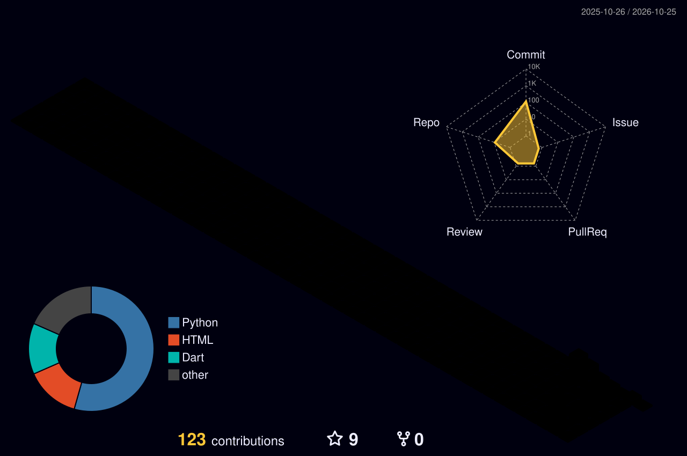

  

<picture>
  <source media="(prefers-color-scheme: dark)" srcset="https://raw.githubusercontent.com/sonubiswal/sonubiswal/output/github-snake-dark.svg" />
  <source media="(prefers-color-scheme: light)" srcset="https://raw.githubusercontent.com/sonubiswal/sonubiswal/output/github-snake.svg" />
  
</picture>

 

## The Banner Follows the Sun

The header at the top changes through nine scenes across the day, timed to India Standard Time, by a small GitHub Action. Each scene is a single hand-coded animated SVG.

<b>See all nine scenes</b> &nbsp;(swapped automatically by IST time of day)

 

| 🌄 Dawn 4:30 – 6:30 AM | 🌅 Sunrise 6:30 – 9:30 AM | 🌤️ Morning 9:30 AM – 12 PM |
|:---:|:---:|:---:|
|  |  |  |

| ☀️ Noon 12 – 3 PM | 🌞 Afternoon 3 – 5 PM | 🌇 Sunset 5 – 6:30 PM |
|:---:|:---:|:---:|
|  |  |  |

| 🌆 Dusk 6:30 – 7:30 PM | 🌙 Night 7:30 – 11:30 PM | 🌌 Midnight 11:30 PM – 4:30 AM |
|:---:|:---:|:---:|
|  |  |  |

 

## Contact

Interested in forecasting, geospatial tooling, or applied ML? Open an issue, star a repo, or reach out. I'm happy to talk shop.

  

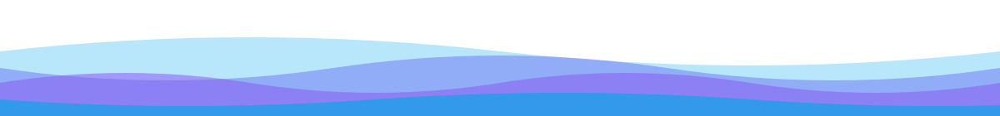